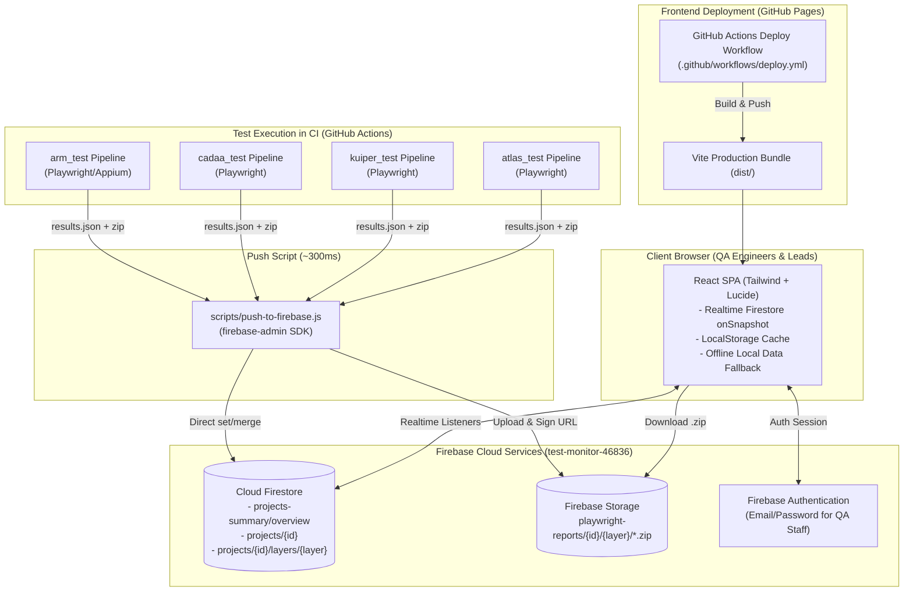

# TestMonitor — Project Context & Transfer Document

> **Target Audience**: AI Agents (Claude, ChatGPT, etc.) and Engineers onboarding to this codebase.  
> **Repository**: `uoseftalaat/Test_monitor`  
> **Last Updated**: October 2026  
> **Tech Stack**: React 18, Vite 6, Tailwind CSS 3, Firebase (Firestore, Auth, Storage), GitHub Actions, GitHub Pages.

---

## 1. Executive Summary & What the Project Does

### 1.1 The Problem It Solves
Modern automated testing pipelines (Playwright for Web/API, Appium for Mobile) run in continuous integration (CI) workflows. When tests fail:
- QA testers and managers are forced to navigate complicated CI logs (e.g. GitHub Actions execution logs).
- Trace recordings and HTML reports expire or require repository/CI permission to download.
- Flaky tests and historical regressions are hard to track over time across multiple services.

### 1.2 The Solution: TestMonitor
**TestMonitor** is a serverless, real-time QA test monitoring and observability dashboard hosted on **GitHub Pages** backed by **Firebase Firestore & Firebase Storage**.

Key capabilities:
1. **Centralized Multi-Project Support**:
   - Out of the box tracks: **ARM (`arm_test`)**, **Cadaa (`cadaa_test`)**, **Kuiper (`kuiper_test`)**, and **Atlas (`atlas_test`)**.
   - Executive Overview: Cross-project pass rates, failure counts, and health status indicators.
2. **Three-Layer Test Architecture**:
   - 🌐 **Web**: Playwright browser automation test suites.
   - ⚡ **API**: Playwright API / HTTP integration test suites.
   - 📱 **Mobile**: Appium / E2E mobile test suites.
3. **Pipeline Log Replacement & Diagnostics**:
   - Displays exact error messages (e.g., `TimeoutError`, `AssertionError`, `500 Internal Server Error`).
   - Pinpoints failing step/snippet and syntax-highlighted ANSI terminal stack traces with 1-click clipboard copy.
4. **Interactive Playwright `.zip` Archives**:
   - CI pipelines zip and upload full interactive Playwright HTML report packages directly to Firebase Storage.
   - Testers can download the `.zip` from the dashboard and inspect network logs, videos, and step-by-step traces completely offline.
5. **30-Day Rolling Regression History**:
   - Per-test daily pass/fail sparklines for the past month.
   - Daily audit breakdown (date, CI run ID, status, duration, error reason).
6. **Ultra-Fast Real-Time CI Push**:
   - Pipelines bypass Git commits and push test results directly to Firestore via Node.js Admin SDK in **~300ms** with zero merge conflicts.
   - Dashboard updates live via Firestore `onSnapshot` listeners.

---

## 2. System Architecture & Diagrams

### 2.1 End-to-End System Architecture



---

### 2.2 Firestore Database Schema & Hierarchy

```
Firestore Root
│
├── 📄 projects-summary / overview
│   ├── lastUpdated: ISO String
│   ├── totalProjects: Number
│   ├── overallSummary: { totalTests, totalPassed, totalFailed, totalFlaky, totalSkipped, passRate }
│   └── projects: Array of [
│         {
│           id: "arm",
│           name: "ARM",
│           description: "...",
│           repoUrl: "...",
│           lastUpdated: ISO String,
│           summary: { total, passed, failed, flaky, skipped, passRate },
│           layers: { web: 98.5, api: 100, mobile: 100 }
│         },
│         ...
│       ]
│
└── 📁 projects / {projectId} (e.g. 'arm', 'cadaa', 'kuiper', 'atlas')
    │
    ├── 📄 Document: projects/{projectId}  (Project Manifest)
    │   ├── projectId: "arm"
    │   ├── projectName: "ARM"
    │   ├── description: "..."
    │   ├── repoUrl: "..."
    │   ├── lastUpdated: ISO String
    │   ├── summary: { total, passed, failed, flaky, skipped, passRate }
    │   └── layers: {
    │         web: { name: "Web", total, passed, failed, flaky, skipped, passRate, playwrightZip, playwrightZipUrl },
    │         api: { name: "API", total, passed, failed, flaky, skipped, passRate, playwrightZip, playwrightZipUrl },
    │         mobile: { name: "Mobile", total, passed, failed, flaky, skipped, passRate, notConfigured: boolean }
    │       }
    │
    └── 📁 Subcollection: projects/{projectId}/layers / {layerId} ('web' | 'api' | 'mobile')
        └── 📄 Document: projects/{projectId}/layers/{layerId}
            ├── projectId: "arm"
            ├── projectName: "ARM"
            ├── layer: "web"
            ├── layerName: "Web"
            ├── lastUpdated: ISO String
            ├── summary: { total, passed, failed, flaky, skipped, passRate }
            ├── playwrightZip: { url, fileName, sizeBytes, uploadedAt, runId, storagePath }
            ├── playwrightZipUrl: "https://..."
            ├── runsHistory: [
            │     { date: "2026-10-18", runId: "123", total, passed, failed, flaky, skipped, passRate }
            │   ]
            └── tests: [
                  {
                    id: "arm-web-spec-login-title",
                    layer: "web",
                    suite: "Authentication > Login",
                    title: "User successfully logs in",
                    file: "tests/auth/login.spec.ts",
                    currentStatus: "passed" | "failed" | "flaky" | "skipped",
                    durationMs: 1420,
                    lastRunAt: ISO String,
                    latestError: { message, stack, step } | null,
                    history30d: [
                      { date: "2026-10-18", runId: "123", status: "passed", durationMs: 1420, error?: string }
                    ]
                  }
                ]
```

---

### 2.3 Frontend Component & State Flow

```mermaid
graph TD
    App["App.jsx (Root Container)"]

    %% Hooks
    useAuth["useAuth() hook\n- Firebase Auth State\n- bypassAuthForFallback\n- requiresAuth flag"]
    useProjectData["useProjectData() hook\n- Firestore onSnapshot\n- Local fallback loader\n- LocalStorage caching\n- Auto-refresh timer"]

    App --> useAuth
    App --> useProjectData

    %% Top Level
    Navbar["Navbar.jsx\n- Project tabs\n- Refresh trigger\n- Auto-refresh interval\n- User login/logout\n- Live status badge"]
    Footer["Footer.jsx"]
    AuthModal["AuthModal.jsx\n- Email/Password form\n- Offline preview bypass"]

    App --> Navbar
    App --> Footer
    App --> AuthModal

    %% Views
    GlobalOverview["GlobalOverview.jsx (selectedProject === 'all')"]
    ProjectView["ProjectView.jsx (selectedProject !== 'all')"]
    TestDetailModal["TestDetailModal.jsx (selectedTest !== null)\n- Stack trace ANSI viewer\n- Failure categorization\n- 30-day run history"]

    App --> GlobalOverview
    App --> ProjectView
    App --> TestDetailModal

    %% GlobalOverview Children
    MetricCard["MetricCard.jsx (KPI Cards)"]
    ProjectCard["ProjectCard.jsx (Grid Cards)"]
    GlobalOverview --> MetricCard
    GlobalOverview --> ProjectCard

    %% ProjectView Children
    ProjectHeader["ProjectHeader.jsx (Title & Pass Rate)"]
    LayerTabs["LayerTabs.jsx (All | Web | API | Mobile)"]
    ProjectKpiGrid["ProjectKpiGrid.jsx (KPIs for project/layer)"]
    PlaywrightZipBanner["PlaywrightZipBanner.jsx (.zip download banner)"]
    DailyFailures["DailyFailures.jsx (Today's failed tests breakdown)"]
    TestFilters["TestFilters.jsx (Search & Filter controls)"]
    TestTable["TestTable.jsx (Test cases list + 30-day sparklines)"]

    ProjectView --> ProjectHeader
    ProjectView --> LayerTabs
    ProjectView --> ProjectKpiGrid
    ProjectView --> PlaywrightZipBanner
    ProjectView --> DailyFailures
    ProjectView --> TestFilters
    ProjectView --> TestTable
```



---

### 2.4 File Directory Map

```
Test_monitor/
├── .github/
│   └── workflows/
│       └── deploy.yml                        # GitHub Actions automated deploy to Pages
├── public/
│   ├── data/                                 # Offline fallback data (zero templates)
│   │   ├── projects-summary.json
│   │   └── projects/{arm,cadaa,kuiper,atlas}/{manifest,web,api,mobile}.json
│   └── favicon.svg
├── scripts/
│   ├── push-to-firebase.js                   # CI entry point: pushes JSON + zips to Firebase
│   ├── reset-all-data.js                     # Admin script: resets local files and Firestore to 0
│   └── migrate-local-data-to-firebase.js     # Seeds Firestore from public/data/
├── src/
│   ├── constants/
│   │   ├── layers.js                         # Web, API, Mobile layers definitions & Lucide icons
│   │   ├── projects.js                       # Default list of projects (ARM, Cadaa, Kuiper, Atlas)
│   │   └── status.js                         # Status colors, priority ordering (failed > flaky > passed > skipped)
│   ├── hooks/
│   │   ├── useAuth.js                        # Firebase Auth lifecycle, bypass logic
│   │   └── useProjectData.js                 # Firestore onSnapshot listeners + fallback caching
│   ├── utils/
│   │   ├── ansi.js                           # Regex stripper & ANSI code parser
│   │   ├── cn.js                             # Tailwind clsx + twMerge utility
│   │   └── formatters.js                     # Date, time, bytes, duration formatting
│   ├── firebase/
│   │   ├── config.js                         # Firebase App, Auth, and Firestore initialization
│   │   ├── authService.js                    # Sign-in and auth observer abstractions
│   │   └── dataService.js                    # Firestore realtime query subscriptions & fallback fetchers
│   ├── components/
│   │   ├── auth/AuthModal.jsx                # Login modal with offline preview bypass button
│   │   ├── common/
│   │   │   ├── AnsiText.jsx                  # Tokenized terminal style ANSI renderer
│   │   │   ├── MetricCard.jsx                # Reusable stat card UI
│   │   │   └── StatusBadge.jsx               # Passed/Failed/Flaky/Skipped pill badge
│   │   ├── layout/
│   │   │   ├── Navbar.jsx                    # Navigation bar with project switcher and controls
│   │   │   └── Footer.jsx                    # Footer
│   │   ├── overview/
│   │   │   ├── GlobalOverview.jsx            # Executive all-projects summary
│   │   │   └── ProjectCard.jsx               # Project card in overview grid
│   │   ├── project/
│   │   │   ├── ProjectView.jsx               # Single project dashboard
│   │   │   ├── ProjectHeader.jsx             # Title, description, repo link, overall health
│   │   │   ├── LayerTabs.jsx                 # Web / API / Mobile switcher
│   │   │   ├── ProjectKpiGrid.jsx            # 4 KPI cards (Total, Passed, Failed, Flaky)
│   │   │   ├── PlaywrightZipBanner.jsx       # Downloadable Playwright report .zip banner
│   │   │   ├── DailyFailures.jsx             # Today's failing tests highlight banner
│   │   │   ├── TestFilters.jsx               # Search input, status filter buttons, suite dropdown
│   │   │   └── TestTable.jsx                 # Filtered table with 30-day sparklines
│   │   ├── AuthModal.jsx                     # (Legacy re-export)
│   │   ├── GlobalOverview.jsx                # (Legacy re-export)
│   │   ├── Navbar.jsx                        # (Legacy re-export)
│   │   ├── ProjectView.jsx                   # (Legacy re-export)
│   │   └── TestDetailModal.jsx               # Detailed test inspector with full stack trace
│   ├── App.jsx                               # Main application container
│   ├── index.css                             # Tailwind directives & dark theme utilities
│   └── main.jsx                              # React DOM mount point
├── firestore.rules                           # Cloud Firestore security rules
├── index.html                                # HTML root template
├── package.json                              # Dependencies & run scripts
├── tailwind.config.js                        # Tailwind setup
└── vite.config.js                            # Vite bundler configuration with manualChunks
```

---

## 3. Current Issues & Bugs (Priority Ranked)

The following issues are actively present in the codebase and should be addressed by the next agent/engineer:

---

### 🔴 Issue 1: "Daily Playwright Report" Section Disconnect (`playwrightReport` missing in `push-to-firebase.js`)
- **Severity**: High (Functional Bug)
- **Files**:
  - `scripts/push-to-firebase.js`
  - `src/components/project/ProjectView.jsx` (lines 92–114)
  - `src/components/project/DailyFailures.jsx`
- **Root Cause**:
  `ProjectView.jsx` computes `activePlaywrightReports` by inspecting `layers[l]?.playwrightReport?.hasFailures`. In the original file-based script (`scripts/ingest-test-run.js`), a `playwrightReport` object containing `{ hasFailures, failedCount, failedTests, reportUrl }` was generated. However, when migrating to `scripts/push-to-firebase.js`, this object was omitted from `updatedLayerPayload`.
- **Symptom**:
  Even if CI pushes 20 failing tests, the "Daily Playwright Report" section on the frontend will always state: *"Daily Playwright Report: Clean Run — No failures reported today"*.
- **Fix Needed**:
  In `scripts/push-to-firebase.js`, when `lFailed > 0`, construct the `playwrightReport` object with `hasFailures: true`, `failedCount: lFailed`, and the top failing tests, and include it in `updatedLayerPayload`. Alternatively, have `ProjectView.jsx` / `DailyFailures.jsx` dynamically derive today's failures from `tests.filter(t => t.currentStatus === 'failed')` without relying on a static object.

---

### 🔴 Issue 2: Global KPI Cards Permanently Stuck at Zero (`overallSummary` not recalculated in `push-to-firebase.js`)
- **Severity**: High (Data Inconsistency)
- **Files**:
  - `scripts/push-to-firebase.js` (lines 516–538)
  - `src/components/overview/GlobalOverview.jsx`
- **Root Cause**:
  When `push-to-firebase.js` updates `projects-summary/overview`, it updates the specific project's summary in `summaryData.projects[projIdx]`. However, it **never recalculates `summaryData.overallSummary`** (`totalTests`, `totalPassed`, `totalFailed`, `totalFlaky`, `passRate`).
- **Symptom**:
  The 4 main KPI cards at the top of the **Executive Overview** page ("Overall Pass Rate", "Total Monitored Tests", "Active Failures", "Flaky Tests") stay permanently at 0% and 0 tests, regardless of how many test results are pushed.
- **Fix Needed**:
  In `scripts/push-to-firebase.js`, after updating `summaryData.projects[projIdx]`, recompute `summaryData.overallSummary` by reducing across all `summaryData.projects`:
  ```javascript
  const allProjects = summaryData.projects || [];
  const tot = allProjects.reduce((acc, p) => acc + (p.summary?.total || 0), 0);
  const pass = allProjects.reduce((acc, p) => acc + (p.summary?.passed || 0), 0);
  const fail = allProjects.reduce((acc, p) => acc + (p.summary?.failed || 0), 0);
  const flak = allProjects.reduce((acc, p) => acc + (p.summary?.flaky || 0), 0);
  const skip = allProjects.reduce((acc, p) => acc + (p.summary?.skipped || 0), 0);
  summaryData.overallSummary = {
    totalTests: tot,
    totalPassed: pass,
    totalFailed: fail,
    totalFlaky: flak,
    totalSkipped: skip,
    passRate: tot > 0 ? Number(((pass / tot) * 100).toFixed(1)) : 100
  };
  ```

---

### 🟠 Issue 3: Firestore 1 MiB Document Limit Hazard
- **Severity**: Medium-High (Scalability / Architectural Bottleneck)
- **Files**:
  - `scripts/push-to-firebase.js`
  - `src/firebase/dataService.js`
- **Root Cause**:
  Firestore has a hard ceiling of **1,048,576 bytes (1 MiB)** per document. `projects/${projectId}/layers/${layer}` stores the entire array of `tests: [...]`. Each test contains:
  - Error message
  - Error stack trace (which can be several kilobytes of ANSI text)
  - Failing code step snippet
  - `history30d` array
  In test suites with 500+ tests (like `arm_test` API or Web), or when stack traces are long, the document size approaches or exceeds 1 MiB, causing `db.set()` to crash with `INVALID_ARGUMENT: Document exceeds maximum size of 1048576 bytes`.
- **Fix Needed**:
  1. Strip ANSI escape sequences and truncate stack traces to ~2 KB before saving in `push-to-firebase.js`.
  2. Long-term architectural fix: Move individual tests into a subcollection: `projects/{projectId}/layers/{layer}/tests/{testId}`, or store the full diagnostic blob in Firebase Storage and reference its URL in the test record.

---

### 🟠 Issue 4: Unbounded Accumulation of `history30d` on Frequent CI Runs
- **Severity**: Medium (Data Bloat)
- **Files**:
  - `scripts/push-to-firebase.js` (lines 388–397)
- **Root Cause**:
  In `push-to-firebase.js`:
  ```javascript
  existing.history30d = (existing.history30d || []).filter(h => new Date(h.date) >= cutoffDate);
  existing.history30d.push({ date: todayStr, runId, status: incoming.status, ... });
  ```
  While `runsHistory` deduplicates runs on the same calendar day, `existing.history30d` pushes a new entry on **every pipeline run**. If CI triggers 15 times a day (pull requests, merges, scheduled cron runs), a single test accumulates 450 history items in 30 days, exacerbating the 1 MiB document limit.
- **Fix Needed**:
  Deduplicate or replace the entry for the current day, or keep only the latest run per day:
  ```javascript
  const history = (existing.history30d || []).filter(h => new Date(h.date) >= cutoffDate);
  const dayIdx = history.findIndex(h => h.date === todayStr);
  const runRecord = { date: todayStr, runId, status: incoming.status, durationMs: incoming.durationMs, ...(incoming.error ? { error: incoming.error.message } : {}) };
  if (dayIdx >= 0) {
    history[dayIdx] = runRecord; // or append only if distinct runId, with a max cap of 30 entries
  } else {
    history.push(runRecord);
  }
  existing.history30d = history;
  ```

---

### 🟠 Issue 5: Deleted or Renamed Tests Linger Indefinitely in Firestore
- **Severity**: Medium (Metric Drift)
- **Files**:
  - `scripts/push-to-firebase.js`
- **Root Cause**:
  When tests run, incoming tests are matched by `testId` against `existingLayerData.tests`. If a test is deleted or renamed in the Playwright codebase, it is never removed from Firestore. It will permanently remain in `tests[]` with its last known status. If that last status was `failed`, it permanently degrades the project's pass rate.
- **Fix Needed**:
  Add a flag or reconciliation step: if `--layer <layer>` was run in full, any test in `existingLayerData.tests` whose file matches the suite run but was not present in the new report should either be marked obsolete or pruned. Alternatively, provide a `--prune` CLI flag.

---

### 🟡 Issue 6: Firebase Storage Signed URL Expiration & Public Access Permissions
- **Severity**: Medium (Asset Access)
- **Files**:
  - `scripts/push-to-firebase.js` (lines 280–295)
  - `firestore.rules` (missing `storage.rules`)
- **Root Cause**:
  - `getSignedUrl` requires the Google Cloud Service Account to possess `roles/iam.serviceAccountTokenCreator`. In many minimal CI service accounts, this permission is missing.
  - The fallback `file.makePublic()` fails on Google Cloud Storage buckets where **Uniform Bucket-Level Access (UBLA)** or **Public Access Prevention** is enforced (which is default on new Firebase projects).
  - There is no `storage.rules` defined in the repository.
- **Fix Needed**:
  1. Add a `storage.rules` file that allows read access to authorized QA users.
  2. In `push-to-firebase.js`, prefer creating a Firebase Storage download token (`metadata.firebaseStorageDownloadTokens = uuid()`) which allows public reading via `https://firebasestorage.googleapis.com/v0/b/...` without requiring service account token creator permissions or bucket-level public access.

---

### 🟡 Issue 7: Unauthenticated Dashboard Access Dilemma
- **Severity**: Medium (User Experience)
- **Files**:
  - `firestore.rules`
  - `src/components/auth/AuthModal.jsx`
  - `src/hooks/useAuth.js`
- **Context**:
  `firestore.rules` specifies `allow read: if request.auth != null;`. Because public self-registration is disabled and QA staff accounts must be created manually in Firebase Console, any user visiting the public GitHub Pages site is immediately stopped by the `AuthModal`.
  Clicking "Preview with Local Data" loads `public/data/` which contains zeroed-out templates.
- **Decision Required**:
  If the dashboard is meant to be visible to internal management without logging in, Firestore rules should allow public read access for `projects-summary` and `projects/**` while restricting writes to CI service accounts (`allow write: if false;`).

---

### 🟡 Issue 8: Codebase Redundancy (Legacy Duplicate Component Files)
- **Severity**: Low (Technical Debt)
- **Files**:
  - `src/components/AuthModal.jsx` (re-exports `./auth/AuthModal`)
  - `src/components/GlobalOverview.jsx` (re-exports `./overview/GlobalOverview`)
  - `src/components/Navbar.jsx` (re-exports `./layout/Navbar`)
  - `src/components/ProjectView.jsx` (re-exports `./project/ProjectView`)
- **Fix Needed**:
  Since `src/App.jsx` now imports directly from the subdirectories (`./components/layout/Navbar`, `./components/project/ProjectView`, etc.), these root-level re-export files can be safely removed to eliminate confusion.

---

### 🟡 Issue 9: Duplication of Project Registry Config
- **Severity**: Low (Maintenance)
- **Files**:
  - `src/constants/projects.js`
  - `scripts/reset-all-data.js`
  - `public/data/projects-summary.json`
- **Root Cause**:
  Adding a new project (e.g. project #5) currently requires manual edits in 3 separate locations.
- **Fix Needed**:
  Make `src/constants/projects.js` the single canonical source of truth imported by both frontend and scripts (using Node.js ESM imports).

---

## 4. Key Scripts & How to Run Them

```bash
# 1. Start local development server
npm run dev

# 2. Build for production (Vite)
npm run build

# 3. Preview production build locally
npm run preview

# 4. Push CI test results to Firebase (Used in GitHub Actions)
node scripts/push-to-firebase.js \
  --project arm \
  --layer web \
  --report path/to/results.json \
  --zip-report path/to/playwright-report.zip \
  --run-id ${{ github.run_id }}

# 5. Reset all metrics to clean zeros across local files AND Firestore
node scripts/reset-all-data.js

# 6. Seed Firestore from local files
node scripts/migrate-local-data-to-firebase.js
```

---

## 5. Summary Checklist for the Incoming AI Tool / Engineer

When continuing work on this project, the recommended order of tasks is:
1. **Fix Issue #1**: Restore `playwrightReport` in `push-to-firebase.js` so daily failure cards show up in `DailyFailures.jsx`.
2. **Fix Issue #2**: In `push-to-firebase.js`, recalculate `overallSummary` so the 4 KPI cards on the Executive Overview reflect real data.
3. **Fix Issue #4**: Bound `test.history30d` to 1 entry per calendar day (max 30 entries) to avoid Firestore payload explosion.
4. **Fix Issue #3**: Sanitize ANSI codes and cap stack traces before committing tests to Firestore to stay safely under the 1 MiB limit.
5. **Decide on Authentication Policy (Issue #7)**: Determine whether GitHub Pages should allow public read access in `firestore.rules` or require provisioned email/password logins.
